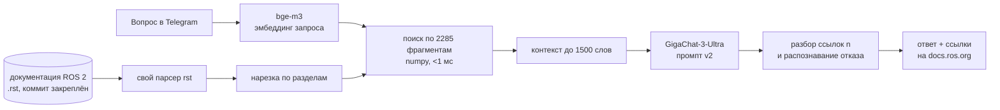

# ROS 2 RAG-ассистент

**Telegram-бот, который отвечает на вопросы о ROS 2 на русском по официальной документации, ставит ссылки на её разделы и честно говорит, когда ответа в документации нет.**


От типичного «чат-бота с PDF» его отличает то, что каждое решение подкреплено замером. Я собрал
и проверил тестовый набор из 60 вопросов, сравнил 18 конфигураций поиска и 2 модели. Качество ответов
оценено по рубрике, а итог проверен на отложенной выборке, которая не участвовала в подборе.

## Главные цифры

| | dev (34 + 6 вопросов) | test (17 + 3, отложенная) |
|---|---|---|
| Правильный раздел документации найден (Recall@5, bge-m3) | **0.88** | **0.88** |
| Ответ полностью верен (оценка по рубрике) | **79%** | **65%** |
| Ответ ошибочен | 3% | 12% |
| Обоснованность ответа фрагментами, 0–2 | 1.85 | 1.94 |
| Честный отказ на вопросы, которых нет в документации | **6 / 6** | **3 / 3** |
| Время ответа (медиана): поиск + GigaChat | ~0.03 с + 1.0 с | ~0.03 с + 1.2 с |

## Как выглядит ответ

Реальные ответы бота из оценки (промпт v2, GigaChat-3-Ultra):

> **— Паблишер у меня с best effort, а подписчик reliable — и сообщения не доходят. Это нормально?**
>
> Да, это нормально. Согласно таблице совместимости политик надёжности (reliability), соединение между паблишером с политикой `Best effort` и подписчиком с политикой `Reliable` не устанавливается (`No`), поэтому сообщения не доставляются. [5]
>
> **Источники:** [5] [About Quality of Service settings › QoS compatibilities](https://docs.ros.org/en/lyrical/ROS-Framework/interfaces/topics/About-Quality-of-Service-Settings.html#qos-compatibilities)

> **— Как отправить goal экшену из консоли и при этом видеть промежуточный фидбек?**
>
> Используйте команду `ros2 action send_goal` с флагом `--feedback`:
> `ros2 action send_goal --feedback /turtle1/rotate_absolute turtlesim_msgs/action/RotateAbsolute "{theta: -1.57}"` [3]

> **— Какой драйвер NVIDIA и версию CUDA ставить на Ubuntu, чтобы PyTorch увидел видеокарту?**
>
> В документации ROS 2 я этого не нашёл.
>
> *(Первая версия промпта на этот вопрос посоветовала `nvidia-driver-535`, которого нет в документации.
> Как это нашли и исправили, описано ниже.)*

## Как устроено



- **Корпус:** 288 страниц документации ROS 2 Lyrical (~320 тыс. слов). Парсер reStructuredText написан
  с нуля, без Sphinx. Вкладки Windows/macOS выброшены, чтобы одна инструкция не попадала в индекс трижды.
  Вкладки C++/Python и XML/YAML сохранены с подписями. Подстановки `{DISTRO}` и `include` раскрываются.
- **Поиск:** `BAAI/bge-m3`, нарезка по разделам документа, прямой перебор в numpy. Векторная база
  не нужна: 2285 векторов × 1024 занимают около 9 МБ, и полный перебор быстрее любого сервиса.
- **Генерация:** GigaChat (SDK `gigachat`). Ответ строится только по фрагментам: команды копируются
  дословно, номера фрагментов `[n]` превращаются в ссылки, при отсутствии ответа выдаётся фиксированная фраза отказа.
- **Интерфейсы:** Telegram-бот на aiogram 3 (индикатор «печатает…», кнопки 👍/👎, лог обратной связи)
  и HTTP API на FastAPI (`POST /ask`, документация на `/docs`).

## Что показали эксперименты

### 1. Поиск: 18 конфигураций

Полная таблица — [`results/ablation_dev.md`](results/ablation_dev.md). Каждая строка — запуск по YAML-конфигу из `configs/`.

| Конфигурация | Recall@5 dev | Recall@10 dev | MRR@10 dev | Recall@1500 слов dev | Recall@5 test |
|---|---|---|---|---|---|
| BM25, нарезка по разделам | 0.53 | 0.62 | 0.41 | 0.62 | 0.59 |
| multilingual-e5-base, по абзацам | 0.82 | 0.85 | 0.59 | 0.82 | 0.77 |
| **bge-m3, по разделам** ← в боте | **0.88** | **0.97** | 0.66 | **0.94** | **0.88** |
| гибрид BM25 + bge-m3 (RRF) | 0.68 | 0.77 | 0.64 | 0.71 | 0.82 |
| гибрид + реранкер bge-reranker-v2-m3 | 0.88 | 0.91 | **0.80** | 0.88 | — |

*Recall@1500 слов* показывает, нашёлся ли правильный раздел среди первых фрагментов общим объёмом
до 1500 слов (столько уходит в контекст LLM). Метрика нужна, чтобы честно сравнивать нарезки разной длины.
Значимость считалась парным bootstrap по вопросам (`src/rag/compare_runs.py`).

- **Эмбеддинги против BM25: +35 п.п. Recall@5, значимо.** Лучше на 12 вопросах из 34, хуже ни на одном.
  BM25 по русскому вопросу к английскому тексту работает только за счёт латинских терминов в вопросе
  (`ros2 topic`, `colcon`): если таких терминов два и больше, Recall@5 = 0.62, если почти нет — 0.38.
- **Гибрид с BM25 на dev значимо хуже bge-m3** (−21 п.п. Recall@5, хуже на 7 вопросах, лучше ни на одном),
  и взвешивание RRF не помогает. **На test эффект слабее и в пределах шума** (0.82 против 0.88 по Recall@5,
  по Recall@10 гибрид даже чуть выше). Вывод: на этих данных гибрид не нужен, но универсальным законом это не является.
- **Реранкер поднимает MRR на 0.14, но 95% ДИ касается нуля**, а стоит 3,3–3,9 с на вопрос.
  В боте его нет: правильный раздел и так попадает в контекст в 94% случаев.
- **Не доказано на 34 вопросах:** e5 против bge-m3 по Recall@5, выбор нарезки и влияние префиксов
  `query:`/`passage:` у e5. Для этого нужен набор побольше.

### 2. Генерация: 2 модели, 2 версии промпта

Таблица собирается скриптом — [`results/generation_report.md`](results/generation_report.md).

| Выборка | Модель | Промпт | Полностью верно | Ошибочно | Обоснованность 0–2 | Честный отказ | Ложный отказ |
|---|---|---|---|---|---|---|---|
| dev | GigaChat-2 | v1 | 47% | 12% | 1.15 | 6/6 | 1/34 |
| dev | GigaChat-3-Ultra | v1 | 85% | 3% | 1.68 | 5/6 | 0/34 |
| dev | **GigaChat-3-Ultra** | **v2** | 79% | 3% | **1.85** | **6/6** | 0/34 |
| test | GigaChat-3-Ultra | v1 | 59% | 12% | 1.65 | 2/3 | 2/17 |
| test | **GigaChat-3-Ultra** | **v2** | **65%** | 12% | **1.94** | **3/3** | 2/17 |

- **Модель:** GigaChat-3-Ultra даёт полностью верный ответ почти вдвое чаще, чем GigaChat-2 (85% против 47%).
- **Промпт v1 → v2.** Оценка v1 нашла конкретные ошибки: правило «если ответ частичный, ответь на часть»
  конфликтовало с правилом «если ответа нет, откажись», и модель отвечала из общих знаний (совет про драйвер NVIDIA).
  Кроме того, она пропускала шаги инструкций, однажды выдумала флаг `--allow-overriding` вместо `--symlink-install`
  и выдавала пример для Ubuntu 24.04 за инструкцию для Lyrical. В v2 конфликт убран, внешние знания запрещены,
  шаги требуется перечислять полностью, номер фрагмента ставится только там, где утверждение действительно есть.
  **Промпт выбран по dev**: корректность та же, обоснованность и отказы лучше. Test, на котором ничего не подбиралось,
  подтверждает выбор.
- **Инженерная находка:** на GTX 1650 fp16 оказался в 4 раза *медленнее* fp32 (14,5 с против 3,6 с
  для реранкера на 20 парах, `src/rag/bench_reranker.py`), потому что у видеокарт GTX 16xx слабая половинная точность.
  По умолчанию стоит fp32.

### 3. Как оценивались ответы

Каждый ответ оценён по двум осям, 0/1/2, по [рубрике](eval/grading_rubric.md): **корректность** (решает ли ответ
вопрос пользователя) и **обоснованность** (подтверждается ли каждое утверждение фрагментами, которые получил бот).
Оценщик видит вопрос, эталон, ответ бота и полный текст контекста (`scripts/prepare_grading.py`). Оценку делали
LLM-агенты, не участвовавшие в построении бота, по 20 ответов на агента. Оценки с комментариями лежат
в `results/generation/grades_*.json`. Автоматические метрики (отказы, валидность ссылок, попадание ссылки
в нужный раздел) считаются без LLM (`src/rag/eval_generation.py`).

## Данные и разметка

- **Корпус:** [ros2/ros2_documentation](https://github.com/ros2/ros2_documentation), ветка `lyrical`,
  закреплённый коммит `08601b3`, лицензия **CC BY 4.0** (© Open Robotics и контрибьюторы).
- **Тестовый набор** [`eval/questions.jsonl`](eval/questions.jsonl): 60 вопросов на разговорном русском,
  с типами howto / concept / fact / multi, плюс 9 вопросов, ответа на которые в документации нет.
  Разбиение dev/test 65/35 стратифицировано по типам.
- Правильный ответ привязан к **странице и разделу**, а не к фрагменту, поэтому разметка не зависит от нарезки.
  Каждую разметку перепроверил независимый агент: он искал по всему корпусу *другие* разделы с достаточным
  ответом (добавлено 59) и подтверждал, что на неотвечаемые вопросы ответа действительно нет.

## Ограничения

- Выборки маленькие: 34 + 17 отвечаемых вопросов. Доверительные интервалы широкие, указаны в таблицах.
- Ответы оценивали LLM-агенты, а не эксперты по ROS. Рубрика и комментарии открыты, любую оценку можно проверить.
  dev v1 и dev v2 оценивали разные экземпляры оценщика, так что часть разницы может быть шумом оценки.
- Оставшиеся типичные ошибки: пропуск шага, который был в контексте (установка пакета Cyclone DDS, `apt update`
  после добавления репозитория), и промахи поиска. Два ложных отказа на test — это случаи, когда нужная страница
  не попала в контекст.
- Одна версия ROS 2 (Lyrical Luth); вопросы про ROS 1 и чужие пакеты намеренно остаются без ответа.

## Запуск

Нужны Python 3.10–3.12, ключ [GigaChat API](https://developers.sber.ru/studio) (бесплатный для физлиц)
и токен Telegram-бота от @BotFather.

```bash
git clone https://github.com/Devo4kaRobot/ros2-rag-assistant.git && cd ros2-rag-assistant
python -m venv .venv && source .venv/bin/activate      # Windows: .venv\Scripts\activate
pip install torch --index-url https://download.pytorch.org/whl/cu126   # или .../whl/cpu
pip install -r requirements.txt

# документация ROS 2 на том коммите, по которому размечен тестовый набор
mkdir -p data/raw/ros2_documentation && cd data/raw/ros2_documentation && git init -q \
  && git fetch -q --depth 1 https://github.com/ros2/ros2_documentation.git 08601b3c41cf4be349eae5774bc92a9594788641 \
  && git checkout -q FETCH_HEAD && cd -
python src/rag/build_corpus.py

cp .env.example .env                    # вписать GIGACHAT_CREDENTIALS и TELEGRAM_BOT_TOKEN
python src/rag/check_env.py             # проверка: ключи (маской), сертификат, модели GigaChat, Telegram
python src/rag/ask.py "как посмотреть список топиков?"
python src/bot/main.py                  # Telegram-бот
uvicorn rag.api:app --app-dir src --port 8000   # HTTP API
```

**Docker:** `docker compose up --build` поднимает API и бота. Корпус собирается при сборке образа,
модели и эмбеддинги хранятся в томах.

**Воспроизвести эксперименты:**

```bash
python src/rag/run_ablation.py                       # все конфиги поиска → results/ablation_dev.md
python src/rag/compare_runs.py 03_bm25_structural 10_bgem3_structural   # парное сравнение
python src/rag/eval_generation.py --model GigaChat-3-Ultra --prompt v2  # ответы + автометрики
python scripts/make_report.py                        # таблица качества ответов
pytest -q                                            # 27 тестов, без сети и GPU
```

> Сетевые тонкости (актуально в РФ): запросы к GigaChat идут мимо системного прокси, а для HTTPS
> автоматически собирается файл корневых сертификатов «certifi + НУЦ Минцифры». Если Telegram открывается
> только через VPN, бот берёт прокси из `HTTPS_PROXY`/`TELEGRAM_PROXY`.

## Структура

```
src/rag/       rst_parser, build_corpus, chunking, bm25, embeddings, retrievers,   ← корпус и поиск
               eval_retrieval, run_ablation, compare_runs, bench_reranker          ← эксперименты
               llm, pipeline, eval_generation, api, settings, check_env, ask       ← генерация и сервис
src/bot/       Telegram-бот (aiogram 3) и форматирование ответа
configs/       18 конфигураций поиска (строки таблицы абляций)
eval/          тестовый набор и рубрика оценки
results/       таблицы, ответы по каждому вопросу, оценки с комментариями
scripts/       подготовка оценки, сборка отчёта, .bat-скрипты для Windows
tests/         27 тестов (парсер, нарезка, поиск, метрики, пайплайн на фиктивной LLM)
```

## Лицензия

Код — MIT. Текст документации ROS 2 — CC BY 4.0, используется с указанием авторства.
